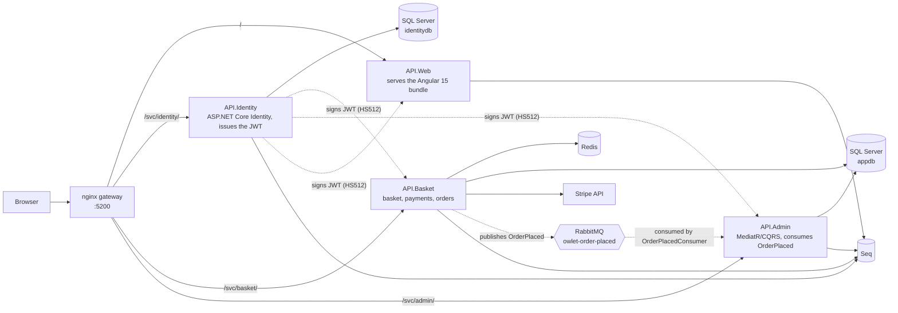

# Owlet — a .NET microservices storefront

Four ASP.NET Core services behind an nginx gateway: a JWT issued by one and
validated independently by the others, a Redis-backed basket, two separate SQL
Server databases, an order event published to RabbitMQ by one service and
consumed by another, Serilog shipping structured logs from all four to Seq, and
the whole stack in one `docker compose up`.


*Sign in, add to the basket, then place an order while sitting on the admin
**Order events** page. The new row appears within the page's two-second poll —
it exists only because `API.Basket` published an `OrderPlaced` message and
`API.Admin` consumed it off RabbitMQ. Recorded against the Compose stack; the
whole clip is real pages on `http://localhost:5200`.*

---

## Why this repo is here

The subject is a storefront. The **shape** is an integration platform:

- a service that accepts events from the outside world and must not lose them,
- a durable transactional store for the records that matter,
- a hot cache for the ephemeral state that doesn't,
- contracts between services that must not silently drift,
- structured logs from every hop, collected in one place,
- and the whole thing reproducible in containers by someone who has never seen it.

That is the same architecture as a freight or EDI integration layer with
different nouns.

## Honest history

This repository was built between 2019 and 2023 as a personal project, and in
2026 it was audited and repaired. The audit found that a lot of what the
architecture diagram implied was not actually wired up: `EventBus.Messages` was
referenced by no project, the MassTransit registrations and the publish call
were commented out, the one consumer implemented no interface either library
would dispatch to, **no** EF migrations were committed, nginx routed to a single
service, and `API.Admin` was commented out of the Compose file.

All of that is fixed, and the fixes are verified below rather than asserted.
What is still missing has its own section, because a README that names its gaps
is worth more than one that omits them.

---

## The problem it was built to explore

A single ASP.NET monolith serving a storefront forces one deployment, one
database and one scaling decision onto parts of the system that want completely
different things:

- A **basket** is hot, ephemeral, read constantly, and nobody cares if it is lost
  on redeploy.
- An **order** is durable, transactional and audited, and must never be lost.
- **Identity** has different uptime requirements from both, and needs to be
  callable by every other service without them sharing its schema.

The interesting engineering problem is not "split it into services" — it is what
happens to authentication, consistency and local development once you do.

---

## Architecture



Longer notes — project layout, the shared-infrastructure trade-off, the request
path, why each store was chosen — are in
**[docs/architecture.md](docs/architecture.md)**.

### The services

| Service | Responsibility | Storage |
|---|---|---|
| `API.Identity` | ASP.NET Core Identity, registration and sign-in, **issues** the JWT. Owns `identitydb`'s schema | SQL Server `identitydb` |
| `API.Basket` | Basket CRUD, Stripe PaymentIntents and webhook, order creation, **publishes** `OrderPlaced`. Owns `appdb`'s schema | Redis + SQL Server `appdb` |
| `API.Admin` | Product administration via MediatR/CQRS, **consumes** `OrderPlaced` | SQL Server `appdb` |
| `API.Web` | Serves the built Angular bundle | — |

### Supporting projects

| Project | What it is |
|---|---|
| `WebApi.Domain` | Entities, DTOs, repository/service interfaces, specifications, the CQRS marker interfaces over MediatR |
| `WebApi.Infrastructure` | Startup extensions, `TokenService`, `PaymentService`, `OrderService`, the publisher and the consumer's sink, shared by all four hosts |
| `WebApi.Db.Identity` | `AppIdentityDbContext`, its migration, identity seeding |
| `WebApi.Db.Store` | `StoreContext` (EF Core) and its migration, `BasketContext` (Redis), JSON seed data |
| `EventBus.Messages` | The wire contracts, the consumer, and the MassTransit registration for both sides |
| `nginx` | The gateway |

### The parts that were actually difficult

- **The bus, done so it cannot rot again.** `OrderPlaced` lives in
  `EventBus.Messages`, an assembly that **references no domain project** — so a
  change to the `Order` entity cannot silently change the wire format, which is
  exactly what the previous contract allowed by embedding the entity itself.
  `OrderPlacedConsumer` implements `IConsumer<OrderPlaced>` and binds a durable
  queue. Consumption is idempotent on `EventId`, enforced by a unique index,
  because RabbitMQ delivers at least once. And there is now a test that fails if
  a published message does not reach a consumer — the test whose absence let the
  whole path sit dead for three years.

- **Authentication across service boundaries.** `TokenService`
  ([`src/WebApi.Infrastructure/Services/TokenService.cs`](src/WebApi.Infrastructure/Services/TokenService.cs))
  signs with `HmacSha512Signature`. Basket, Admin and Web each validate
  independently through `AddCommonIdentity`
  ([`CommonExtensions.cs`](src/WebApi.Infrastructure/StartupExtensions/CommonExtensions.cs)).
  **No service calls Identity on the request path**, so Identity being down does
  not stop an authenticated user from using their basket. The cost is the usual
  one: a token cannot be revoked before it expires.

- **Basket in Redis, behind an interface.** `IBasketRepository` is implemented by
  `BasketContext` over `StackExchange.Redis`. The consequence that matters: the
  basket survives a restart of `API.Basket`, which an in-process cache would not.

- **Two EF contexts, two databases, one owner each.** `API.Basket` migrates
  `appdb` and `API.Identity` migrates `identitydb`; `API.Admin` reads `appdb` and
  only waits for it, because two services racing to apply the same migrations is
  how a schema ends up half-created.

- **A gateway, not a reverse proxy in front of one service.** nginx serves the
  SPA at `/` and routes `/svc/identity/`, `/svc/basket/` and `/svc/admin/`,
  stripping the prefix. The `/svc` prefix exists because the Angular router
  already owns `/basket`, `/admin`, `/orders` and `/shop`.

---

## Verified, not asserted

Everything below was observed on 16 August 2026 against `docker compose up`
on this machine. Where something was not verified, it says so.

**The stack comes up.** Eleven containers: four services, the gateway, SQL
Server, Redis, RabbitMQ, Seq, smtp4dev, redis-commander. SQL Server, Redis and
RabbitMQ gate the services with health checks, so the APIs no longer race the
database's cold start:

```
[02:25:33 INF] AppIdentityDbContext migrated on attempt 1     (API.Identity)
[02:25:33 INF] StoreContext migrated on attempt 1             (API.Basket)
[02:25:37 INF] StoreContext reachable on attempt 2            (API.Admin)
[02:25:37 INF] Configured endpoint owlet-order-placed, Consumer: EventBus.Messages.Consumers.OrderPlacedConsumer
[02:25:34 INF] Bus started: rabbitmq://rabbitowlet/
```

**The whole loop runs from an empty volume.** `docker compose down -v`, then
`docker compose up -d --build`, then register → sign in → add to basket → place an
order → the event arrives on the admin side, 239 ms after publication, on a
database that did not exist a minute earlier. The GIF above is that loop. The order's
subtotal is re-priced from the database, not taken from the basket: the demo
basket claimed $9.50 for an item the catalogue prices at $1.00, and the order
was written at the catalogue price.

**The message really travels.** With Admin running, an order published at
`02:44:28.4939` was consumed at `02:44:28.4990` — 5 ms:

```
[INF] Consumed OrderPlaced 402e0db1-191f-429f-969c-2eb1bdab9348
      for order 6 (demo@owlet.local, 1 items, total 26.00)
```

**A durable queue means Admin can be down.** `docker compose stop api.admin`,
then place an order. Checkout still returns 200, and the broker holds the
message:

```
name                 messages  consumers
owlet-order-placed          1          0
```

Start Admin again and it drains, 14.3 seconds after publication — the exact
length of the outage. That row is still visible in
[docs/order-events.png](docs/order-events.png) with a `14280 ms` bus latency.

**The basket survives a restart.** `docker compose restart api.basket`, then
re-read the basket: same contents, because it is in Redis and not in the process.

**All four services log to Seq.** 23 events from `API.Admin`, 22 from
`API.Basket`, 16 from `API.Identity`, 6 from `API.Web`, each tagged with a
`Service` property — [docs/seq.png](docs/seq.png).

**Build and tests.** `dotnet build Owlet.sln` succeeds with no warnings and no
Node.js installed. `dotnet test` runs **25 tests, all passing**, none of which
need Docker.

**Four defects were found only by running it**, and are fixed with tests:
registration returned 500 on every request; only the first order after a fresh
start could ever succeed; the SQL Server health check never passed; and Seq
crash-looped. The commit `Fix four defects found by actually running the stack`
has the details.

**Size:** ~7,000 lines of C# across 165 files in 9 projects, ~3,700 lines of
TypeScript in the Angular client, 133 commits since September 2019.

There is **no hosted demo**, deliberately. An honest deployment needs SQL Server,
Redis, RabbitMQ, Seq and four .NET containers; no free tier runs that without
cold-starting a five-service stack in front of whoever clicked the link.

---

## Stack

**Backend** — .NET 6, ASP.NET Core, EF Core 6, ASP.NET Core Identity, MassTransit
8 (RabbitMQ), MediatR 11, AutoMapper 12, FluentValidation 11, Stripe.net 41,
StackExchange.Redis 2.6, Swashbuckle 6.5, Serilog (+ Seq sink)
**Front end** — Angular 15.1, RxJS 7.8, NgRx Store 15.3, Angular Material 15,
ngx-bootstrap 10, ngx-toastr 16, Bootstrap 5.2 / Bootswatch, TypeScript 4.9
**Infrastructure** — Docker Compose, nginx, SQL Server 2019, Redis 6, RabbitMQ 3,
Seq, smtp4dev, redis-commander
**Tests** — xUnit 2.4, 25 tests, including a MassTransit in-memory harness test
that asserts a published message reaches its consumer

---

## Running it

Full instructions, including running without Docker, are in
**[docs/running.md](docs/running.md)**. The short version:

```bash
git clone https://github.com/yurii1exe/ECommerce-Restaurant.git
cd ECommerce-Restaurant

# Configuration. Real values are never committed, only templates.
cp .env.template .env                                        # set SA_PASSWORD
cp src/WebApi.Domain/Common.env.template src/WebApi.Domain/Common.env

# The signing key: TokenService signs with HS512, so it needs 64 bytes.
openssl rand -base64 64        # paste into Common.env as Token__Key

docker compose up --build
```

The compose files sit next to `Owlet.sln`, so that is the whole command. Then
open **http://localhost:5200**.

| | URL |
|---|---|
| Storefront and gateway | http://localhost:5200 |
| Order events (the async path, live) | http://localhost:5200/admin/order-events |
| Seq (logs from all four services) | http://localhost:5342 |
| RabbitMQ management (`guest`/`guest`) | http://localhost:8088 |
| redis-commander | http://localhost:8081 |
| smtp4dev | http://localhost:5010 |
| Swagger | :5041, :5031, :5011 `/swagger` |

Swagger is registered only in the Development environment. The three API services
run as Development under Compose; `API.Web` runs as Production because that is
what makes it serve the built bundle instead of trying to launch the Angular CLI,
so it has no Swagger and answers `/swagger` with the SPA's index page.

Locally, use `dotnet user-secrets` rather than editing `appsettings.json`:

```bash
cd src/API.Identity
dotnet user-secrets set "Token:Key" "<your 64-byte key>"
```

Stripe is optional and only the payment path needs it; there is no default key
and the code fails fast with an explanatory message rather than falling back to
a committed one.

---

## What is still wrong

Written in 2026 after fixing everything above. These are real, not modesty.

**1. There is no transactional outbox.** `OrderService` commits the order and
then publishes. Those are two operations with no transaction across them, so a
crash in the gap loses the event silently — the order exists and nothing
downstream ever hears about it. MassTransit's EF Core outbox is the fix and it
is the next change this project needs. Until then the failure mode is documented
rather than solved.

**2. No correlation IDs.** All four services log to one Seq instance, which is
most of the value, but nothing ties the lines from one checkout together. A
correlation ID through the request pipeline and the message headers is cheap and
is the highest-value remaining change to the logging story.

**3. The signing key was 16 characters, and short keys fail quietly.**
`TokenService` signs with HS512; RFC 7518 §3.2 requires a key at least as large
as the algorithm's hash output — 512 bits. The committed key was
`"super secret key"`: 128 bits, a quarter of the requirement. It never threw,
because the token library enforces a blanket minimum rather than the
per-algorithm minimum, so a key that clears the floor but not the requirement is
accepted in silence. `AnUndersizedKeyIsAcceptedSilently_WhichIsHowTheDefectSurvived`
is a characterisation test that proves it.

**4. Configuration was wrong from the first commit.** Real connection strings and
the signing key were committed into `appsettings.json`, and into `bin/` output
that was also committed. `HEAD` is now templates plus `REPLACE_ME` placeholders,
with real values in `.env`, `Common.env` and user-secrets. The history still
contains the old values: rewriting it would break five branches and every clone
and would not un-publish anything, so the honest fix was to rotate, not to
pretend.

**5. Symmetric signing distributes the minting key.** Every service that merely
needs to *validate* a token holds the key that can *issue* one. RS256 with a
published JWKS is the right shape. Related: the token lives for 7 days,
`GenerateRefreshToken()` exists but nothing consumes it, and `Expires` uses
`DateTime.Now` rather than `UtcNow`, so on a non-UTC host the stated expiry is
off by the machine's offset.

**6. Parts of the admin client are still stubs.** `admin/manage-users` calls
`${environment.identityApi}Account`, but `identityApi` is an object in the
client's environment, so that URL interpolates to `[object Object]Account`. The
CQRS handlers behind product administration are real; the user-management screen
is not. It is flagged here rather than quietly left to be discovered.

**7. Checkout in the browser needs a Stripe key.** The wizard's final step
creates a PaymentIntent. Without `StripeSettings:SecretKey` the API path works
and the UI's last step does not, which is why the demo places its order through
the API that the wizard itself calls.

**8. It is on .NET 6 and Angular 15**, both out of support. If this were live
that would be the top of this list rather than the bottom.

---

## Scope and provenance

A personal learning project, built between 2019 and 2023 in my own time and
repaired in 2026. Not a production system, not deployed anywhere, and not derived
from any employer's code or from paid course material. The product images under
`src/API.Web/wwwroot/images` are third-party marketing photographs used as
placeholder catalogue data; they are not mine and are not licensed for reuse.

## Licence

No licence has been applied. All rights reserved; ask if you want to reuse it.
