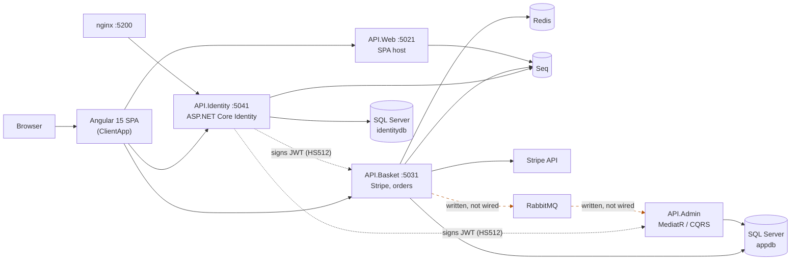

# Owlet — a .NET microservices storefront

An e-commerce backend split into four ASP.NET Core services with an Angular front
end: JWT issued by one service and validated independently by the others, a
Redis-backed basket, two separate SQL Server databases, Stripe payments, Serilog
shipping structured logs to Seq, and the whole stack defined in Docker Compose.

Built as a personal project between 2019 and 2023 to learn distributed-system
mechanics by building one rather than by reading about one.

> **If you are evaluating this repo, read [What I'd do differently](#what-id-do-differently).**
> It is an honest audit of where this falls short — including one significant path
> (asynchronous order publishing over RabbitMQ) that is written but never wired up.
> I would rather tell you that than have you find it.

---

## Why this repo is here

The subject is a storefront. The **shape** is an integration platform:

- a service that accepts events from the outside world and must not lose them,
- a durable transactional store for the records that matter,
- a hot cache for the ephemeral state that doesn't,
- contracts between services that must not silently drift,
- structured logs from every hop, collected in one place,
- and the whole thing reproducible in containers by someone who has never seen it.

That is the same architecture as a freight or EDI integration layer with different
nouns. It is the reason this stays public: it is the artifact that shows the
distributed-system reasoning, not the artifact that shows the domain.

---

## The problem it was built to explore

A single ASP.NET monolith serving a storefront forces one deployment, one database
and one scaling decision onto parts of the system that want completely different
things:

- A **basket** is hot, ephemeral, read constantly, and nobody cares if it is lost
  on redeploy. It wants an in-memory store.
- An **order** is durable, transactional and audited. It wants a relational
  database and it must never be lost.
- **Identity** has different uptime requirements from both, and needs to be
  callable by every other service without them sharing its schema.

Putting all three behind one `DbContext` means the basket's read volume sits on the
same connection pool as order writes, and a change to identity redeploys checkout.
The interesting engineering problem is not "split it into services" — it is what
happens to authentication, consistency and local development once you do.

---

## Architecture



Longer notes — project layout, the shared-infrastructure decision, the request
path, and why each store was chosen — are in
**[docs/architecture.md](docs/architecture.md)**.

### The services

| Service | Responsibility | Storage | State |
|---|---|---|---|
| `API.Identity` | ASP.NET Core Identity, registration and sign-in, **issues** the JWT | SQL Server `identitydb` | Complete |
| `API.Basket` | Basket CRUD, Stripe PaymentIntents and webhook, order creation | Redis + SQL Server `appdb` | Complete |
| `API.Web` | Hosts the Angular SPA | — | Complete for dev; see caveats |
| `API.Admin` | Product administration via MediatR/CQRS | SQL Server `appdb` | Partial, and not in Compose |

### Supporting projects

| Project | What it is |
|---|---|
| `WebApi.Domain` | Entities, DTOs, repository/service interfaces, specifications, the thin CQRS marker interfaces over MediatR |
| `WebApi.Infrastructure` | The largest project (~1,600 lines). Startup extensions, `TokenService`, `PaymentService`, `OrderService`, Swagger and JWT wiring shared by all four hosts |
| `WebApi.Db.Identity` | `AppIdentityDbContext` + identity seeding |
| `WebApi.Db.Store` | `StoreContext` (EF Core) **and** `BasketContext` (Redis), plus JSON seed data |
| `EventBus.Messages` | RabbitMQ publisher and consumers — see the caveat below |
| `nginx` | Reverse proxy container config |

### The parts that were actually difficult

- **Authentication across service boundaries.** `TokenService`
  ([`src/WebApi.Infrastructure/Services/TokenService.cs`](src/WebApi.Infrastructure/Services/TokenService.cs))
  signs a JWT with `HmacSha512Signature` from `Token:Key`. `API.Basket` and
  `API.Admin` each validate it independently through the shared
  `AddCommonIdentity` extension
  ([`src/WebApi.Infrastructure/StartupExtensions/CommonExtensions.cs`](src/WebApi.Infrastructure/StartupExtensions/CommonExtensions.cs)),
  which registers `AddJwtBearer` with the same key and issuer. **No service calls
  Identity on the request path** — the token carries the claims they need, so
  Identity being down does not stop an authenticated user from using their basket.
  Identity configures its own `JwtBearer` separately because it needs an
  `OnMessageReceived` hook to pull `access_token` off the query string for SignalR.

- **Basket in Redis, behind an interface.** `IBasketRepository`
  ([`src/WebApi.Domain/Interfaces/Repositories/IBasketRepository.cs`](src/WebApi.Domain/Interfaces/Repositories/IBasketRepository.cs))
  is implemented by `BasketContext`
  ([`src/WebApi.Db.Store/BasketContext.cs`](src/WebApi.Db.Store/BasketContext.cs))
  over `StackExchange.Redis`, serialising with `System.Text.Json` and a 30-day TTL.
  The consequence that mattered: a basket survives a restart of `API.Basket`, and a
  second Basket instance sees the same data — which an in-process cache would not.

- **Two EF Core contexts, two databases.** `AppIdentityDbContext` and
  `StoreContext` live in separate projects against separate SQL Server databases, so
  an identity schema change cannot touch the store schema. Both are created and
  seeded at startup from JSON in `src/WebApi.Db.Store/SeedData/`.

- **Four thin hosts over one infrastructure library.** Almost all cross-cutting
  wiring — JWT, Swagger with a Bearer security scheme, AutoMapper profiles, the
  generic repository and unit of work — lives in `WebApi.Infrastructure` as
  `IServiceCollection` extensions. `API.Web` is 156 lines of C# in total as a
  result. Getting the seam right was more of the work than any individual feature.

- **Stripe including the webhook.** `PaymentService`
  ([`src/WebApi.Infrastructure/Services/PaymentService.cs`](src/WebApi.Infrastructure/Services/PaymentService.cs))
  creates and updates PaymentIntents and writes `PaymentIntentId` and
  `ClientSecret` onto the basket; `PaymentsController` handles the
  `payment_intent.succeeded` / `payment_intent.payment_failed` callbacks via
  `EventUtility.ConstructEvent`. The webhook is the half people skip.

- **Structured logging that crosses services.** Serilog on `API.Identity`,
  `API.Basket` and `API.Web`, all sinking to a **Seq** container, so one request can
  be looked at in one place instead of being reconstructed from three sets of
  console output.

---

## What works today

Verified against the source, not from memory:

- Register and sign in through `API.Identity`, receive a JWT, and use it against
  `API.Basket` — which validates it without ever touching `identitydb`.
- The basket survives `docker restart api.basket`, because it is in Redis.
- Stripe test-mode PaymentIntent creation, update, and webhook handling.
- Product create/read/update/delete through `API.Admin`'s MediatR handlers.
- Both databases created and seeded on first start.
- Swagger UI on each API in Development.

**Size:** ~5,500 lines of C# across 157 files in 9 projects, ~3,500 lines of
TypeScript in the Angular client, 128 commits between September 2019 and March 2023.

There is **no hosted demo**, and that is deliberate. An honest deployment needs SQL
Server, Redis, RabbitMQ, Seq and four .NET containers; no free tier runs that
without cold-starting a five-service stack in front of whoever clicked the link.
`docker compose up` and the source are the demo.

---

## Stack

**Backend** — .NET 6, ASP.NET Core, EF Core 6.0.10, ASP.NET Core Identity, MediatR
11, AutoMapper 12, FluentValidation 11, Stripe.net 41, StackExchange.Redis 2.6,
Swashbuckle 6.5, Serilog.AspNetCore 6.1 (+ Serilog.Sinks.Seq 5.2)
**Front end** — Angular 15.1, RxJS 7.8, NgRx Store 15.3, Angular Material 15,
ngx-bootstrap 10, ngx-toastr 16, ngx-spinner 15, xng-breadcrumb 9, Bootstrap 5.2 /
Bootswatch, TypeScript 4.9
**Infrastructure** — Docker Compose, nginx, SQL Server 2019, Redis 6, RabbitMQ 3,
Seq, smtp4dev, redis-commander, Portainer
**Tests** — xUnit 2.4 (`tests/WebApi.Test`) — 4 tests, covering JWT issuance and
cross-service validation, plus a Redis cache fixture. Thin, and item 4 below says
so plainly.

---

## Running it

Full instructions, including running without Docker, are in
**[docs/running.md](docs/running.md)**. The short version:

```bash
git clone https://github.com/yurii1exe/ECommerce-Restaurant.git
cd ECommerce-Restaurant

# 1. Configuration. Real values are never committed — only templates are.
cp src/WebApi.Domain/Common.env.template src/WebApi.Domain/Common.env
cp .env.template .env

# 2. Generate a signing key (64 bytes — the code signs with HS512)
openssl rand -base64 64        # paste into Common.env as Token__Key
# and set a strong SA_PASSWORD in .env

# 3. The Compose files expect to run from the repository root
cp docker/docker-compose*.yml docker/.dockerignore .
docker compose up
```

| Service | URL |
|---|---|
| nginx (fronts Identity) | http://localhost:5200 |
| API.Identity | http://localhost:5041 |
| API.Basket | http://localhost:5031 |
| API.Web | http://localhost:5021 |
| Seq (logs) | http://localhost:5342 |
| RabbitMQ management | http://localhost:8088 |
| redis-commander | http://localhost:8081 |
| smtp4dev (mail catcher) | http://localhost:5010 |

Locally I use `dotnet user-secrets` rather than editing `appsettings.json`:

```bash
cd src/API.Identity
dotnet user-secrets init
dotnet user-secrets set "Token:Key" "<your 64-byte key>"
```

Stripe is not optional if you want the payment path: set
`StripeSettings:SecretKey` the same way, with your own test-mode key.

The Angular client is run separately for development
(`cd src/API.Web/ClientApp && npm install && ng serve`) — `API.Web` proxies to the
Angular CLI dev server rather than serving a built bundle.

> **Honest caveat:** the Compose stack was last run in 2023 against .NET 6 base
> images. It is not re-verified as of this README. `dotnet build` on the solution
> passes for every C# project (the `API.Web` project also runs `tsc`, which needs
> `npm install` in `ClientApp` first).

---

## What I'd do differently

Written in 2026, after coming back to this cold. These are real defects, not
modesty.

**1. Configuration was wrong from the first commit.** Real connection strings and a
JWT signing key were committed straight into `appsettings.json` — and into `bin/`
output that also got committed. The right answer is templates in the repo, real
values in user-secrets or the environment, and a `.gitignore` written *before* the
first commit rather than six years after it. That is now fixed in `HEAD`:
`Common.env.template` and `.env.template` are committed, the real files are ignored,
and every `appsettings.json` carries a `REPLACE_ME` placeholder. The history still
contains the old values — rewriting it would break five branches and every clone,
and would not un-publish anything, so the honest fix was to rotate, not to pretend.

**2. The signing key was 16 characters.** `TokenService` signs with **HS512**, and
RFC 7518 §3.2 requires a key at least as large as the algorithm's hash output —
512 bits, or 64 bytes. The key in use was `"super secret key"`: 128 bits, a quarter
of what the algorithm requires. It never failed loudly, because the token library
enforces a blanket minimum key size rather than the per-algorithm minimum the RFC
specifies, so a key that clears the floor but not the requirement is accepted in
silence. That is the worst failure mode there is: cryptography that quietly does
less than you think it does. Every token this system ever issued was weaker than
its own algorithm claimed.

**3. The asynchronous order path is written but not wired.** This is the biggest
gap, and the previous README implied otherwise. `EventBus.Messages` contains a
RabbitMQ publisher (`RabbitMqManager`) and two consumers, RabbitMQ is in the
Compose file, and `RabbitMqHost` is in configuration — but:

- no project references `EventBus.Messages`, so none of it is even compiled into a
  running service;
- the MassTransit registration in `BasketExtensions` and `AdminExtensions` is
  commented out;
- the publish call in `OrderService` is commented out;
- `OrderReceivedConsumer` extends RabbitMQ.Client's `DefaultBasicConsumer` and has
  a MassTransit-shaped `Consume(ConsumeContext<T>)` method but does not implement
  `IConsumer<T>` — it is half-migrated between two libraries and would not be
  invoked by either;
- and the one message contract, `OrderMessageDTO`, lives in `WebApi.Domain`, not in
  the shared contracts project that exists specifically to hold it.

Checkout therefore writes the order synchronously. The lesson is the one this repo
teaches best: **a message bus in your `docker-compose.yml` is not a message bus in
your system**, and the gap between the two is invisible unless something tests it.

**4. No test covers the thing most likely to break.** There were two tests. One
constructed a `TokenService` with a `null` `IConfiguration` — it threw a
`NullReferenceException` and had been failing for years — and asserted only that the
result was a non-empty string not containing "Bearer". It checked no claim, no
signature, no issuer, no expiry. The other needs a live local Redis.

I have since rewritten the token tests so that they assert the property that
actually matters: that a token minted the way `API.Identity` mints it survives
validation configured the way `API.Basket` and `API.Admin` configure it, with the
claims intact. One of them is a characterisation test proving defect 2 empirically —
a 128-bit key against HS512 produces a valid-looking token and raises nothing.

That still leaves the real gap: a contract change between a publisher and a
consumer — the failure mode that actually bites in this architecture — has no test
at all. Which is precisely how defect 3 survived for three years.

**5. The reverse proxy fronts one service.** `nginx.local.conf` declares upstreams
for the SPA and the basket and then comments both out; only `api.identity` is
routed. Calling it an API gateway would be generous. The browser talks to three
services on three ports, which means CORS is doing work a gateway should be doing.

**6. Loose ends that should have been closed or deleted.** `API.Admin` is commented
out of `docker-compose.yml` and its `UserFunc` commands are empty class declarations
with no handlers. `API.Web` calls `UseAuthentication()` without ever registering an
authentication scheme, and carries a `Token` section nothing reads. Autofac is
referenced and a container module written, but nothing ever installs it. No EF
migrations are committed — startup calls `EnsureCreatedAsync()` *and*
`MigrateAsync()`, which is two strategies for the same job. Half-built is worse than
absent, because it makes the architecture diagram lie.

**7. No correlation IDs.** Serilog and Seq get the logs into one place, but without
a correlation ID flowing through the HTTP calls and message headers you still cannot
cleanly follow one checkout across services. It is the first thing I would add, and
it is cheap.

**8. It is on .NET 6 and Angular 15**, both out of support. If this were live that
would be the top of the list rather than the bottom of it.

---

## Scope and provenance

A personal learning project, built between 2019 and 2023 in my own time. Not a
production system, not deployed anywhere, and not derived from any employer's code
or from paid course material. The name "Owlet" and the restaurant framing are
incidental — the architecture is the point.

## Licence

No licence has been applied. All rights reserved; ask if you want to reuse it.
