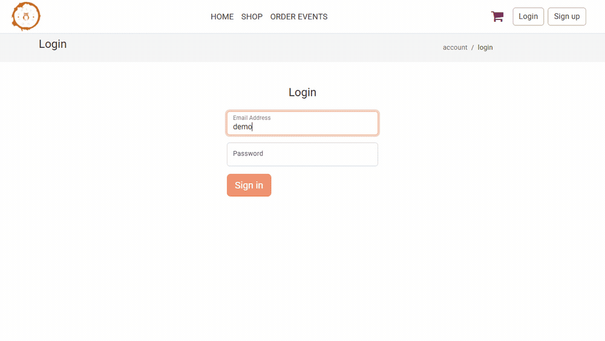

# Owlet — a .NET microservices storefront

Four ASP.NET Core services behind an nginx gateway: a JWT issued by one and
validated independently by the others, a Redis-backed basket, two separate SQL
Server databases, an order event published to RabbitMQ by one service and
consumed by another, Serilog shipping structured logs from all four to Seq, and
the whole stack in one `docker compose up`.



*Sign in, add to the basket, then place an order while sitting on the admin
**Order events** page. The new row appears within the page's two-second poll —
it exists only because `API.Basket` published an `OrderPlaced` message and
`API.Admin` consumed it off RabbitMQ. Recorded against the Compose stack; the
whole clip is real pages on `http://localhost:5200`.*

---

## Why this repo is here

The subject is a storefront. The **shape** is an integration platform:

- a service that accepts events from the outside world and must not lose them,
- a durable transactional store for the records that matter,
- a hot cache for the ephemeral state that doesn't,
- contracts between services that must not silently drift,
- structured logs from every hop, collected in one place,
- and the whole thing reproducible in containers by someone who has never seen it.

That is the same architecture as a freight or EDI integration layer with
different nouns.

## The problem it was built to explore

A single ASP.NET monolith serving a storefront forces one deployment, one
database and one scaling decision onto parts of the system that want completely
different things:

- A **basket** is hot, ephemeral, read constantly, and nobody cares if it is lost
  on redeploy.
- An **order** is durable, transactional and audited, and must never be lost.
- **Identity** has different uptime requirements from both, and needs to be
  callable by every other service without them sharing its schema.

The interesting engineering problem is not "split it into services" — it is what
happens to authentication, consistency and local development once you do.

---

## Architecture


Longer notes — project layout, the shared-infrastructure trade-off, the request
path, why each store was chosen — are in
**[docs/architecture.md](docs/architecture.md)**.

### The services

| Service | Responsibility | Storage |
|---|---|---|
| `API.Identity` | ASP.NET Core Identity, registration and sign-in, **issues** the JWT. Owns `identitydb`'s schema | SQL Server `identitydb` |
| `API.Basket` | Basket CRUD, Stripe PaymentIntents and webhook, order creation, **publishes** `OrderPlaced`. Owns `appdb`'s schema | Redis + SQL Server `appdb` |
| `API.Admin` | Product administration via MediatR/CQRS, **consumes** `OrderPlaced` | SQL Server `appdb` |
| `API.Web` | Serves the built Angular bundle | — |

### Supporting projects

| Project | What it is |
|---|---|
| `WebApi.Domain` | Entities, DTOs, repository/service interfaces, specifications, the CQRS marker interfaces over MediatR |
| `WebApi.Infrastructure` | Startup extensions, `TokenService`, `PaymentService`, `OrderService`, the publisher and the consumer's sink, shared by all four hosts |
| `WebApi.Db.Identity` | `AppIdentityDbContext`, its migration, identity seeding |
| `WebApi.Db.Store` | `StoreContext` (EF Core) and its migration, `BasketContext` (Redis), JSON seed data |
| `EventBus.Messages` | The wire contracts, the consumer, and the MassTransit registration for both sides |
| `nginx` | The gateway |

### The decisions that carry the design

- **The message contract is isolated from the domain.** `OrderPlaced` lives in
  `EventBus.Messages`, an assembly that **references no domain project**, so a
  change to the `Order` entity cannot silently change the wire format. A test,
  `TheContractsAssembly_DependsOnNoDomainProject`, keeps it that way.
  `OrderPlacedConsumer` implements `IConsumer<OrderPlaced>` and binds a durable
  queue. Consumption is idempotent on `EventId`, enforced by a unique index,
  because RabbitMQ delivers at least once. A MassTransit harness test asserts
  that a published message reaches its consumer.

- **Authentication across service boundaries.** `TokenService`
  ([`src/WebApi.Infrastructure/Services/TokenService.cs`](src/WebApi.Infrastructure/Services/TokenService.cs))
  signs with `HmacSha512Signature`. Basket, Admin and Web each validate
  independently through `AddCommonIdentity`
  ([`CommonExtensions.cs`](src/WebApi.Infrastructure/StartupExtensions/CommonExtensions.cs)).
  **No service calls Identity on the request path**, so Identity being down does
  not stop an authenticated user from using their basket. The cost is the usual
  one: a token cannot be revoked before it expires.

- **Basket in Redis, behind an interface.** `IBasketRepository` is implemented by
  `BasketContext` over `StackExchange.Redis`. The consequence that matters: the
  basket survives a restart of `API.Basket`, which an in-process cache would not.

- **Two EF contexts, two databases, one owner each.** `API.Basket` migrates
  `appdb` and `API.Identity` migrates `identitydb`; `API.Admin` reads `appdb` and
  only waits for it, because two services racing to apply the same migrations is
  how a schema ends up half-created.

- **A gateway, not a reverse proxy in front of one service.** nginx serves the
  SPA at `/` and routes `/svc/identity/`, `/svc/basket/` and `/svc/admin/`,
  stripping the prefix. The `/svc` prefix exists because the Angular router
  already owns `/basket`, `/admin`, `/orders` and `/shop`.

- **A client with eight runtime dependencies.** Standalone Angular 20 with
  signals and the built-in control flow, styled by one Tailwind v4 `@theme` block
  that every colour, radius, type step and spacing value in the application
  resolves to. `@angular/cdk` drives the checkout stepper because it is a state
  machine with no opinion about how the steps should look; the icons, the toasts,
  the pager, the breadcrumb and the tables are components in this repository.
  Every asynchronous view has a loading, an error and an empty state, and the
  error names the service that did not answer.

- **The machine room is a visible register, not a hidden page.**
  `/admin/order-events` renders what `API.Admin` consumed off RabbitMQ in mono
  with tabular figures, and draws each message's time on the queue as a bar
  scaled against the slowest hop on screen. A hop that waited out a stopped
  consumer is drawn in a different colour from one that crossed in five
  milliseconds, because those are different facts.

---

## Measured

Everything below was observed on 16 August 2026 against `docker compose up`
on this machine.

**The stack comes up.** Eleven containers: four services, the gateway, SQL
Server, Redis, RabbitMQ, Seq, smtp4dev, redis-commander. SQL Server, Redis and
RabbitMQ gate the services with health checks, so the APIs start against a
database that is already accepting connections:

```
[02:25:33 INF] AppIdentityDbContext migrated on attempt 1     (API.Identity)
[02:25:33 INF] StoreContext migrated on attempt 1             (API.Basket)
[02:25:37 INF] StoreContext reachable on attempt 2            (API.Admin)
[02:25:37 INF] Configured endpoint owlet-order-placed, Consumer: EventBus.Messages.Consumers.OrderPlacedConsumer
[02:25:34 INF] Bus started: rabbitmq://rabbitowlet/
```

**The whole loop runs from an empty volume.** `docker compose down -v`, then
`docker compose up -d --build`, then register → sign in → add to basket → place an
order → the event arrives on the admin side, 239 ms after publication, on a
database that did not exist a minute earlier. The GIF above is that loop. The order's
subtotal is re-priced from the database, not taken from the basket: the demo
basket claimed $9.50 for an item the catalogue prices at $1.00, and the order
was written at the catalogue price.

**The message really travels.** With Admin running, an order published at
`02:44:28.4939` was consumed at `02:44:28.4990` — 5 ms:

```
[INF] Consumed OrderPlaced 402e0db1-191f-429f-969c-2eb1bdab9348
      for order 6 (demo@owlet.local, 1 items, total 26.00)
```

**A durable queue means Admin can be down.** `docker compose stop api.admin`,
then place an order. Checkout still returns 200, and the broker holds the
message:

```
name                 messages  consumers
owlet-order-placed          1          0
```

Start Admin again and it drains, 14.3 seconds after publication — the exact
length of the outage. That row is still visible in
[docs/order-events.png](docs/order-events.png) with a `14280 ms` bus latency.

**The basket survives a restart.** `docker compose restart api.basket`, then
re-read the basket: same contents, because it is in Redis and not in the process.

**All four services log to Seq.** 23 events from `API.Admin`, 22 from
`API.Basket`, 16 from `API.Identity`, 6 from `API.Web`, each tagged with a
`Service` property — [docs/seq.png](docs/seq.png).

**The client is the same one the container serves.** With the stack up, the
gateway on `:5200` answers `/`, `/shop`, `/basket`, `/orders`,
`/admin/order-events` and `/account/register` with 200 and renders the built
bundle. The menu draws 9 of 28 products from `/svc/basket`; the order-events page
draws consumed rows from `/svc/admin`. Every request the bundle makes is a
relative `/svc` path, so the browser talks to one origin and CORS does no work.

**The whole purchase runs through the pages.** Driven headless against the stack:
register, add two items, open a product, review the basket, complete the address
and delivery steps of the checkout wizard, place the order, and find it on
`/orders` and on `/admin/order-events` — the second row on that page is the event
the checkout published, consumed 233 ms later.

**Build and tests.** `dotnet build Owlet.sln` succeeds with no warnings and no
Node.js installed. `dotnet test` runs **25 tests, all passing**, none of which
need Docker. `npm run test:ci` in the client runs **72 tests, all passing**, and
`ng lint` reports no errors.

**The client audits clean.** Across thirteen routes at 1360px and 360px: exactly
one `h1` per page, no horizontal scroll, no unlabelled form control, no button or
link without an accessible name, no image without alt text, and no text below
WCAG AA contrast in either the light or the dark theme.

**Size:** ~7,000 lines of C# across 165 files in 9 projects in the backend, plus
the Angular client. The client's initial payload is 378 kB, 109 kB transferred.

There is **no hosted demo**, deliberately. A representative deployment needs SQL
Server, Redis, RabbitMQ, Seq and four .NET containers; no free tier runs that
without cold-starting a five-service stack in front of whoever clicked the link.

---

## Stack

**Backend** — .NET 6, ASP.NET Core, EF Core 6, ASP.NET Core Identity, MassTransit
8 (RabbitMQ), MediatR 11, AutoMapper 12, FluentValidation 11, Stripe.net 41,
StackExchange.Redis 2.6, Swashbuckle 6.5, Serilog (+ Seq sink)
**Front end** — Angular 20 (standalone, signals, built-in control flow),
TypeScript 5.8, RxJS 7.8, Tailwind CSS v4, `@angular/cdk` for the checkout
stepper, `@microsoft/signalr` for chat. Eight runtime dependencies in total.
**Infrastructure** — Docker Compose, nginx, SQL Server 2019, Redis 6, RabbitMQ 3,
Seq, smtp4dev, redis-commander
**Tests** — xUnit 2.4, 25 tests, including a MassTransit in-memory harness test
that asserts a published message reaches its consumer; Karma and Jasmine, 72
tests on the client

---

## Running it

Full instructions, including running without Docker, are in
**[docs/running.md](docs/running.md)**. The short version:

```bash
git clone https://github.com/yurii1exe/ECommerce-Restaurant.git
cd ECommerce-Restaurant

# Configuration. Real values are never committed, only templates.
cp .env.template .env                                        # set SA_PASSWORD
cp src/WebApi.Domain/Common.env.template src/WebApi.Domain/Common.env

# The signing key: TokenService signs with HS512, so it needs 64 bytes.
openssl rand -base64 64        # paste into Common.env as Token__Key

docker compose up --build
```

The compose files sit next to `Owlet.sln`, so that is the whole command. Then
open **http://localhost:5200**.

| | URL |
|---|---|
| Storefront and gateway | http://localhost:5200 |
| Order events (the async path, live) | http://localhost:5200/admin/order-events |
| Seq (logs from all four services) | http://localhost:5342 |
| RabbitMQ management (`guest`/`guest`) | http://localhost:8088 |
| redis-commander | http://localhost:8081 |
| smtp4dev | http://localhost:5010 |
| Swagger | :5041, :5031, :5011 `/swagger` |

Swagger is registered only in the Development environment. The three API services
run as Development under Compose; `API.Web` runs as Production because that is
what makes it serve the built bundle instead of trying to launch the Angular CLI,
so it has no Swagger and answers `/swagger` with the SPA's index page.

Locally, use `dotnet user-secrets` rather than editing `appsettings.json`:

```bash
cd src/API.Identity
dotnet user-secrets set "Token:Key" "<your 64-byte key>"
```

Stripe is optional and only the payment path needs it; there is no default key
and the code fails fast with an explanatory message rather than falling back to
a committed one.

---

## Where this goes next

The four changes that would matter most, in order.

**1. A transactional outbox.** `OrderService` commits the order and then
publishes. Those are two operations with no transaction across them, so a crash
in the gap loses the event. MassTransit's EF Core outbox — writing the message
into `appdb` inside the same `SaveChanges` as the order, with a delivery service
draining it — closes that window, and is the next change this project needs.

**2. Correlation IDs.** All four services log to one Seq instance, which is most
of the value. A correlation ID carried through the request pipeline and the
message headers would tie the lines from a single checkout together, and is the
highest-value remaining change to the logging story.

**3. Asymmetric signing.** Tokens are signed with HS512, so every service that
needs to *validate* a token holds the key that can *issue* one. RS256 with a
published JWKS separates those two capabilities. Alongside it: short-lived access
tokens plus a refresh flow, rather than the current 7-day lifetime.

**4. Rate limiting and auth at the edge.** nginx routes; it does not
authenticate. Terminating both in the gateway — YARP would make it testable
in-process — keeps that policy in one place instead of in each service.

---

## Scope and provenance

A personal project, built in my own time. Not a production system, not deployed
anywhere, and not derived from any employer's code or from paid course
material. The product images under
`src/API.Web/wwwroot/images` are third-party marketing photographs used as
placeholder catalogue data; they are not mine and are not licensed for reuse.

## Licence

No licence has been applied. All rights reserved; ask if you want to reuse it.
